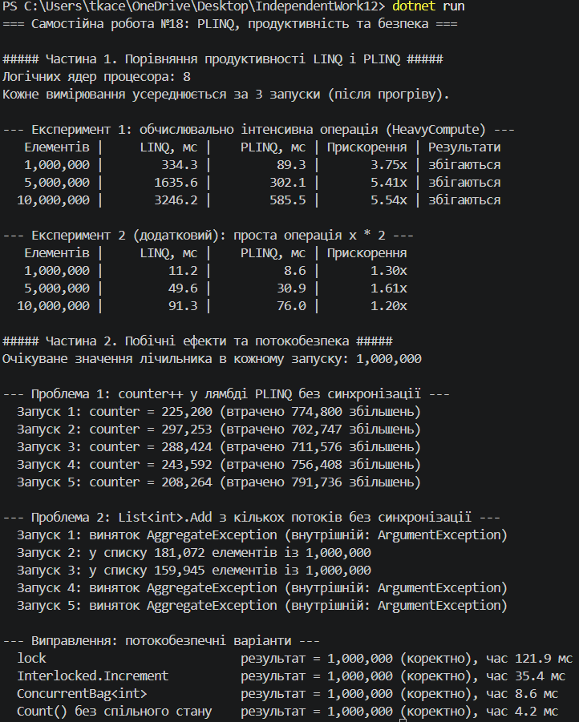

# Звіт із самостійної роботи №18

**З дисципліни:** Об'єктно-орієнтоване програмування
**Тема:** PLINQ: дослідження продуктивності та безпеки
**Виконав:** студент Ткаченко Максим

## 1. Мета роботи

Дослідити переваги та недоліки PLINQ (Parallel LINQ) порівняно зі звичайним LINQ, виміряти його продуктивність на різних обсягах даних і проаналізувати потенційні проблеми безпеки при паралельній обробці.

## 2. Завдання

Індивідуальних варіантів немає: усі студенти виконують однакове дослідження.

1. Створити велику колекцію випадкових чисел (1, 5 і 10 мільйонів елементів).
2. Реалізувати обчислювально інтенсивну операцію для кожного елемента.
3. Порівняти час виконання LINQ (`.Where(...).Select(...)`) і PLINQ (`.AsParallel().Where(...).Select(...)`) за допомогою `Stopwatch`.
4. Дослідити побічні ефекти: показати некоректний результат при зміні спільної змінної в лямбді PLINQ і виправити його потокобезпечними засобами.

## 3. Структура проєкту

- `DataGenerator.cs`: генерація `List<int>` випадкових чисел із фіксованим `Seed = 42`.
- `PerformanceExperiment.cs`: порівняння LINQ і PLINQ на розмірах 1M, 5M, 10M.
- `SideEffectsExperiment.cs`: сценарій із побічними ефектами та його виправлення.
- `Program.cs`: точка входу, послідовно запускає обидва експерименти.
- `.gitignore`: виключає файли збірки (`bin/`, `obj/`) та системні файли.

## 4. Експеримент 1: продуктивність LINQ і PLINQ

### 4.1. Обчислювально інтенсивна операція

Метод `HeavyCompute(int x)` виконує 20 ітерацій з викликами `Math.Sin`, `Math.Sqrt`, `Math.Abs`, `Math.Cos`. Це чиста функція без побічних ефектів, і її вартість для одного елемента помітно більша за вартість накладних витрат на розподіл роботи між потоками.

### 4.2. Запити

```csharp
// звичайний LINQ
data.Where(x => x % 2 == 0).Select(x => HeavyCompute(x)).ToList();

// PLINQ
data.AsParallel().Where(x => x % 2 == 0).Select(x => HeavyCompute(x)).ToList();
```

### 4.3. Методика вимірювання

- Для кожного вимірювання створюється новий `Stopwatch`.
- Перед вимірюваннями виконується прогрів на малій колекції, щоб JIT-компіляція не спотворювала перші результати.
- Кожне значення це середнє за 3 запуски. Перед вимірюванням викликається збирач сміття.
- Запити завершуються `ToList()`, бо LINQ виконується відкладено, і без цього вимірювався б лише час побудови запиту.
- PLINQ без `AsOrdered()` не гарантує порядок елементів, тому результати порівнюються за кількістю та сумою (з невеликою похибкою через різний порядок додавання `double`).
- Додатковий експеримент 2 порівнює LINQ і PLINQ на дуже простій операції `x * 2`.

### 4.4. Результати

Запуск: `dotnet run` у папці проєкту.

```text
=== Самостійна робота №18: PLINQ, продуктивність та безпека ===

##### Частина 1. Порівняння продуктивності LINQ і PLINQ #####
Логічних ядер процесора: 8
Кожне вимірювання усереднюється за 3 запуски (після прогріву).

--- Експеримент 1: обчислювально інтенсивна операція (HeavyCompute) ---
   Елементів |     LINQ, мс |    PLINQ, мс | Прискорення | Результати
   1,000,000 |        334.3 |         89.3 |       3.75x | збігаються
   5,000,000 |       1635.6 |        302.1 |       5.41x | збігаються
  10,000,000 |       3246.2 |        585.5 |       5.54x | збігаються

--- Експеримент 2 (додатковий): проста операція x * 2 ---
   Елементів |     LINQ, мс |    PLINQ, мс | Прискорення
   1,000,000 |         11.2 |          8.6 |       1.30x
   5,000,000 |         49.6 |         30.9 |       1.61x
  10,000,000 |         91.3 |         76.0 |       1.20x

##### Частина 2. Побічні ефекти та потокобезпека #####
Очікуване значення лічильника в кожному запуску: 1,000,000

--- Проблема 1: counter++ у лямбді PLINQ без синхронізації ---
  Запуск 1: counter = 225,200 (втрачено 774,800 збільшень)
  Запуск 2: counter = 297,253 (втрачено 702,747 збільшень)
  Запуск 3: counter = 288,424 (втрачено 711,576 збільшень)
  Запуск 4: counter = 243,592 (втрачено 756,408 збільшень)
  Запуск 5: counter = 208,264 (втрачено 791,736 збільшень)

--- Проблема 2: List<int>.Add з кількох потоків без синхронізації ---
  Запуск 1: виняток AggregateException (внутрішній: ArgumentException)
  Запуск 2: у списку 181,072 елементів із 1,000,000
  Запуск 3: у списку 159,945 елементів із 1,000,000
  Запуск 4: виняток AggregateException (внутрішній: ArgumentException)
  Запуск 5: виняток AggregateException (внутрішній: ArgumentException)

--- Виправлення: потокобезпечні варіанти ---
  lock                           результат = 1,000,000 (коректно), час 121.9 мс
  Interlocked.Increment          результат = 1,000,000 (коректно), час 35.4 мс
  ConcurrentBag<int>             результат = 1,000,000 (коректно), час 8.6 мс
  Count() без спільного стану    результат = 1,000,000 (коректно), час 4.2 мс```

| Елементів | LINQ, мс | PLINQ, мс | Прискорення |
|-----------|----------|-----------|-------------|
| 1 000 000 | 334.3 | 89.3 | 3.75x |
| 5 000 000 | 1635.6 | 302.1 | 5.41x |
| 10 000 000 | 3246.2 | 585.5 | 5.54x |

Кількість логічних ядер процесора мого комп'ютера: 8 .

### 4.5. Аналіз: коли PLINQ виявився швидшим, а коли ні

> **Дописати за своїми результатами.** Нижче наведено причини, які варто перевірити на твоїх цифрах: частина з них проявиться, частина ні.

**Чому PLINQ має бути швидшим на інтенсивній операції:**

- Робота для кожного елемента незалежна й важка, тому її можна розподілити між ядрами. Накладні витрати на розбиття даних і злиття результатів малі порівняно з обчисленнями.
- Чим більше елементів і ядер, тим вищий потенційний виграш. Теоретична межа прискорення дорівнює кількості ядер, на практиці вона нижча.

**Чому PLINQ може не дати виграшу (особливо в експерименті 2 з простою операцією `x * 2`):**

- Сама операція настільки дешева, що витрати на розподіл по потокам, синхронізацію та злиття результатів `ToList()` порівнянні з користю чи перевищують її.
- Обмеження пам'яті: проста операція впирається в пропускну здатність пам'яті, а не в процесор, тому додаткові ядра майже не допомагають.
- На комп'ютері з малою кількістю ядер або під навантаженням фоновими процесами виграш менший.
- Невизначений порядок результатів і додаткові виділення пам'яті для проміжних буферів.

## 5. Експеримент 2: побічні ефекти та потокобезпека

### 5.1. Сценарій із проблемою

Спільна змінна `counter` збільшується всередині лямбди PLINQ без синхронізації:

```csharp
int counter = 0;
data.AsParallel()
    .Select(x => { counter++; return x; })
    .ToList();
// очікуємо counter == 1 000 000
```

**Як виникла проблема.** Операція `counter++` складається з трьох кроків: прочитати значення, збільшити, записати назад. Якщо два потоки прочитають те саме значення одночасно, обидва запишуть однакове число, і одне збільшення втрачається. Це гонка даних (data race). Через неї результат менший за очікуваний і нестабільний: він змінюється від запуску до запуску, тому сценарій виконується 5 разів. Друга демонстрація додає елементи у звичайний `List<int>` з кількох потоків: список не потокобезпечний, тому під час зміни внутрішнього масиву можна отримати втрату елементів або виняток.


```text
чікуване значення лічильника в кожному запуску: 1,000,000

--- Проблема 1: counter++ у лямбді PLINQ без синхронізації ---
  Запуск 1: counter = 225,200 (втрачено 774,800 збільшень)
  Запуск 2: counter = 297,253 (втрачено 702,747 збільшень)
  Запуск 3: counter = 288,424 (втрачено 711,576 збільшень)
  Запуск 4: counter = 243,592 (втрачено 756,408 збільшень)
  Запуск 5: counter = 208,264 (втрачено 791,736 збільшень)

--- Проблема 2: List<int>.Add з кількох потоків без синхронізації ---
  Запуск 1: виняток AggregateException (внутрішній: ArgumentException)
  Запуск 2: у списку 181,072 елементів із 1,000,000
  Запуск 3: у списку 159,945 елементів із 1,000,000
  Запуск 4: виняток AggregateException (внутрішній: ArgumentException)
  Запуск 5: виняток AggregateException (внутрішній: ArgumentException)
```

### 5.2. Виправлення

```csharp
// 1. lock
lock (sync) { lockedCounter++; }

// 2. Interlocked
Interlocked.Increment(ref interlockedCounter);

// 3. потокобезпечна колекція
var bag = new ConcurrentBag<int>();
data.AsParallel().ForAll(x => bag.Add(x));

// 4. взагалі без спільного стану
int counted = data.AsParallel().Select(x => x).Count();
```

**Чому обрані способи підходять:**

- `lock` дозволяє виконувати захищений блок лише одному потоку за раз, тому збільшення не втрачаються. Це універсальний спосіб, але потоки чекають одне одного, тож паралельність зменшується.
- `Interlocked.Increment` виконує збільшення як одну атомарну операцію на рівні процесора, без блокування. Для простого лічильника це швидше за `lock`.
- `ConcurrentBag<T>` це потокобезпечна колекція: її можна безпечно наповнювати з кількох потоків.
- Найкращий підхід: не використовувати спільний змінний стан. Вбудовані оператори PLINQ (`Count`, `Sum`, `Aggregate`) самі безпечно збирають часткові результати з потоків.

```text
--- Виправлення: потокобезпечні варіанти ---
  lock                           результат = 1,000,000 (коректно), час 121.9 мс
  Interlocked.Increment          результат = 1,000,000 (коректно), час 35.4 мс
  ConcurrentBag<int>             результат = 1,000,000 (коректно), час 8.6 мс
  Count() без спільного стану    результат = 1,000,000 (коректно), час 4.2 мс
```
### Скріншоти


## 6. Висновки щодо доцільності використання PLINQ

1. PLINQ найкраще підходить для обчислювально інтенсивних операцій над великими колекціями, де кожен елемент обробляється незалежно від інших.
2. Для простих і дешевих операцій, а також малих колекцій паралелізація може не дати виграшу або навіть сповільнити програму через накладні витрати.
3. Перед використанням PLINQ потрібно вимірювати час на реальних даних, бо виграш залежить від ядер процесора, складності операції та обсягу даних.
4. Побічні ефекти всередині PLINQ-запитів небезпечні: гонка даних дає нестабільні й некоректні результати, які складно знайти й відтворити.
5. Лямбди в PLINQ варто писати як чисті функції без зміни спільного стану. Якщо спільний стан неминучий, використовують `lock`, `Interlocked` або потокобезпечні колекції.
6. Результати PLINQ без `AsOrdered()` не мають гарантованого порядку, що слід враховувати при порівнянні та подальшій обробці.

## 7. Відповіді на контрольні запитання

1. **За яких умов PLINQ зазвичай дає виграш у продуктивності порівняно зі звичайним LINQ?**
   Коли операція над кожним елементом обчислювально важка, елементи оброблюються незалежно, колекція достатньо велика, а комп'ютер має кілька вільних ядер. Тоді витрати на розподіл роботи й збір результатів малі порівняно з користю від паралельних обчислень.
2. **Чому побічні ефекти всередині PLINQ-запитів можуть призводити до некоректних результатів?**
   Лямбди виконуються одночасно в кількох потоках. Якщо вони змінюють спільну змінну чи колекцію без синхронізації, виникає гонка даних: операції потоків перемежовуються, і частина змін втрачається або пошкоджується внутрішній стан (наприклад, `List<T>`). Результат стає нестабільним і залежить від випадкового порядку виконання потоків.
3. **Для чого в експериментах важливо порівнювати кілька розмірів колекції, а не один випадок?**
   Виграш PLINQ залежить від обсягу даних: на малих колекціях накладні витрати можуть перевищувати користь, а на великих паралелізація окупається. Кілька розмірів показують, з якого обсягу PLINQ стає доцільним, і дозволяють побачити тенденцію, а не випадкове значення одного вимірювання.
4. **Які висновки слід зробити, якщо PLINQ виявився повільнішим за LINQ у частині тестів?**
   Це нормально й означає, що для цих умов паралелізація не виправдана: операція надто проста, колекція замала, ядер мало або виконання впирається в пам'ять. Висновок: PLINQ не є універсальним прискорювачем, і його використання треба обґрунтовувати вимірюваннями на реальних даних, а не застосовувати «про запас».

## Джерела

- [Parallel LINQ (PLINQ), Microsoft Docs](https://learn.microsoft.com/dotnet/standard/parallel-programming/parallel-linq-plinq)
- [Understanding speedup in PLINQ, Microsoft Docs](https://learn.microsoft.com/dotnet/standard/parallel-programming/understanding-speedup-in-plinq)
- [Potential pitfalls with PLINQ, Microsoft Docs](https://learn.microsoft.com/dotnet/standard/parallel-programming/potential-pitfalls-with-plinq)
- [Stopwatch class, Microsoft Docs](https://learn.microsoft.com/dotnet/api/system.diagnostics.stopwatch)
